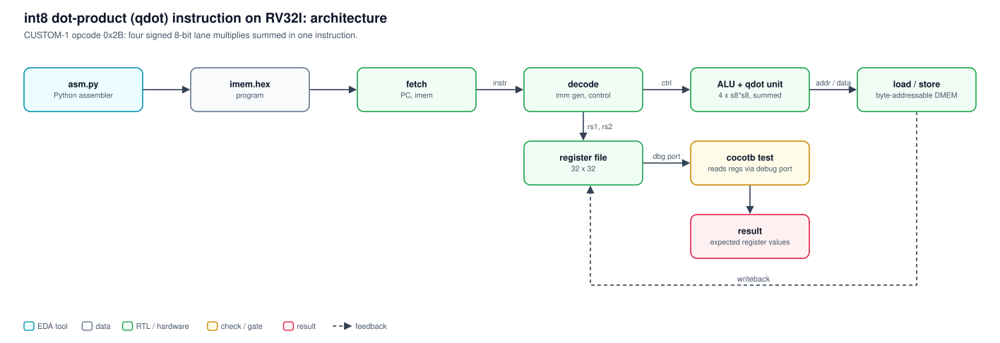
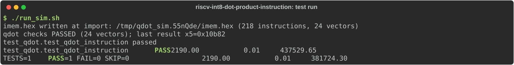

# Quantized-NN instruction (int8 dot-product) on the RV32I core

[](https://github.com/Ana2601/riscv-int8-dot-product-instruction/actions/workflows/ci.yml)

Adds a **packed 4-lane int8 dot-product** custom instruction (`qdot`) to the
RV32I core - the central primitive of quantized neural-network inference
(convolution inner products with int8 activations and weights).



## The instruction

| mnemonic              | encoding                               | semantics |
|-----------------------|----------------------------------------|-----------|
| `qdot rd, rs1, rs2`   | `CUSTOM-1` opcode `0x2B`, `funct3=0`, R-type | `rd = sum_{i=0..3} s8(rs1[8i+7:8i]) * s8(rs2[8i+7:8i])` |

The four 8-bit lanes of `rs1` and `rs2` are multiplied and summed
(-32768..64516 range, kept full-width here). This is exactly the MAC the
hardware does per output pixel in a quantized conv layer - software on a
plain RISC-V would take 4-8 instructions (sign-extend + mul + add), while
`qdot` does it in one.

## Why custom-1 (0x2B)

RISC-V reserves `CUSTOM-0`..`CUSTOM-3` (0x0B/0x2B/0x5B/0x7B) for
application-specific extensions. [riscv-custom-instruction-clz-ctz](https://github.com/Ana2601/riscv-custom-instruction-clz-ctz) used CUSTOM-0 for CLZ/CTZ; this
project uses CUSTOM-1 for the NN dot product - demonstrating that multiple
independent extensions can live side by side without colliding.

## RTL changes (rv32i_core.sv)

1. **Decode**: `is_qdot = (opcode == 0x2B) && (funct3 == 0)`.
2. **Datapath**: an always_comb loop signs-extends each lane
   (`$signed(rs1_data[8*i+7 -: 8])`) and accumulates the products.
3. **Writeback**: `wb_data` muxes `qdot_result`; `wb_we` unchanged.

## Verification

`tb/test_qdot.py` builds a 24-vector quantized workload at module-import time
(writing `imem.hex` before simulation so `$readmemh` is race-free), runs it
through the core, and checks a mismatch flag that must stay 0:

```
** TESTS=1 PASS=1 FAIL=0 SKIP=0
qdot checks PASSED (24 vectors); last result x5=0x10b82
```

The 24 vectors cover negative, positive, and zero lanes in both operands.
The Python reference model (`qdot_ref`) is asserted consistent with the
vectors, giving an independent cross-check of the hardware result.

### Debugging note

An earlier run silently never halted: `imem` was widened to 256 words but the
fetch index stayed `pc[8:2]` (7 bits -> only words 0..127 fetchable), so the
EBREAK at word 217 was unreachable. Fixed to `pc[9:2]` (8-bit index).
Verilator's `%Warning-WIDTHEXPAND` had flagged exactly this.

## Layout

```
src/rv32i_core.sv        core with QDOT extension (fork of rv32i-single-cycle-core)
tb/asm.py                assembler with qdot support
tb/test_qdot.py          24-vector quantized workload (cocotb + Verilator)
run_sim.sh / Makefile    one-command flow
```

## Run

```bash
./run_sim.sh
```

## Next (FPGA host)

- Quantize a tiny classifier / ViT-tiny to int8 and drive full inference
  through the qdot TCA; co-simulate software + RTL on M1.
- Build the soft-SoC (core + qdot accelerator) for the FPGA host for
  measured per-inference latency vs. the software baseline.

## Test run

Output of the CI command (`./run_sim.sh`), captured from a local run:



## Setup

- [OSS CAD Suite](https://github.com/YosysHQ/oss-cad-suite-build) (Icarus Verilog, Verilator, Yosys)
- Python packages: `pip install -r requirements.txt`

```bash
./run_sim.sh
```

The same commands run in CI on every push (`.github/workflows/ci.yml`).
